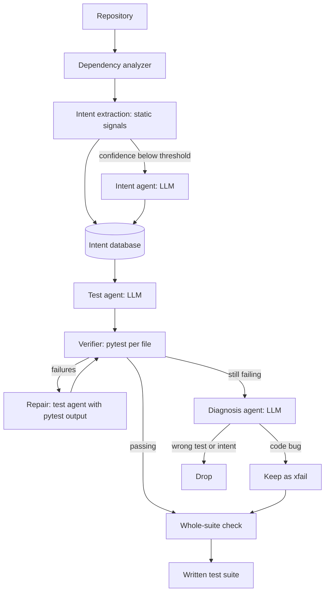

# Architecture

Code2Test turns a Python repository into a passing pytest suite in seven steps: analyze, infer intent, generate, run, repair, diagnose, and check the whole suite. This document describes the modules behind each step and the data they share.

## Data flow

## Modules

| Module | Role |
| --- | --- |
| `code2test/cli/commands/` | Command-line entry points: `test`, `verify`, `benchmark`, `intent`, `report`, `init`, `config` |
| `code2test/cli/utils/model.py` | Chooses the model (`CODE2TEST_MODEL`, saved main model, Azure, Google key, default) |
| `code2test/src/be/dependency_analyzer/` | Parses the repository (derived from the CodeWiki analyzer) and builds the dependency graph; Python components are top-level functions and classes |
| `code2test/core/intent.py`, `core/intent_analyzers/` | Static intent extraction and confidence scoring from docstrings, type hints, naming conventions, call sites and complexity |
| `code2test/agents/intent_agent.py` | Re-infers low-confidence intents with the LLM |
| `code2test/agents/test_agent.py` | Builds the generation prompt (intent, source, import line, related API) and repairs failing tests |
| `code2test/agents/diagnosis_agent.py` | Classifies a failing test as a wrong test, a code bug or a wrong intent |
| `code2test/core/generator.py` | Orchestrates the pipeline: intent phase, generation phase, verify-and-repair loop, whole-suite check, run metrics |
| `code2test/core/verifier.py` | Runs pytest in a subprocess and reads its JUnit XML report |
| `code2test/storage/` | SQLite intent database and test registry in `.code2test/code2test.db` |
| `code2test/core/metrics.py` | Per-run metrics written to `.code2test/metrics.json` |
| `code2test/core/benchmark.py` | Mutation testing and diagnosis-accuracy evaluation for `code2test benchmark` |
| `code2test/core/quality.py` | Behavioral coverage and diagnostic accuracy per component, from the test registry and the last benchmark |
| `code2test/reporting/` | HTML and JSON run and coverage reports |

## Intent extraction

Each component starts from a confidence of 0.5. Static signals add to it: a docstring adds up to 0.30 (more for longer docstrings), type hints add 0.20, a recognized naming convention such as `validate_*` or `is_*` adds 0.15, and call sites add up to 0.20. High cyclomatic complexity subtracts up to 0.15, and the result is clamped to the range 0.1 to 0.99.

When the score is below the threshold (`--confidence`, default 0.6), the intent agent re-infers the intent from the source, and the more confident result is kept. Intents are stored. An intent edited with `code2test intent edit` gets confidence 0.95 and is never replaced by a later run.

In `--auto` mode, a component whose intent is still below the threshold gets no tests, and a component whose tests were already verified in an earlier run keeps them instead of being regenerated. Both are counted in the run metrics.

## Generation

The test agent's prompt contains:

- the intent and its confidence
- the exact import line for the component
- the imports at the top of its module, with relative imports made absolute
- the public API (signatures, constructors and public methods, no bodies) of the component's module and of the project modules it imports
- the signature and up to 16,000 characters of the component's source

The prompt also asks the model to work out each expected value from the source (and to assert a property such as a type, length or exception when it cannot), to build objects exactly as their signatures require, to put any file the code creates under pytest's `tmp_path`, and never to mock the component under test.

The model returns test functions, imports and fixtures as structured output. Each component gets one file, `tests/<package>/test_<module>_<component>.py`. For a package's `__init__.py`, the file is `tests/<package>/test_<component>.py`.

## Verification and repair

The verifier writes the file and runs it with `python -m pytest` in a subprocess. The working directory is a new temporary directory, with `--rootdir` set to the repository, so a test that writes to a relative path cannot touch the user's files. The verifier puts the repository root and `src/` on `PYTHONPATH`, ignores the target project's `addopts`, and turns off bytecode caching, so rewritten files are never served stale.

Results are read from pytest's JUnit XML and matched to the test functions each generated test defines. An error that prevents the file from being collected counts against every test in it. Failing tests, with their failure output, go back to the test agent for up to two repair rounds.

## Diagnosis and the written-suite invariant

Tests that still fail are diagnosed against the stored intent:

- **Code bug:** the test is kept with `pytest.mark.xfail` and the diagnosis as its reason.
- **Wrong test or wrong intent:** the test is dropped.

An error raised by the test itself (an import, syntax or name error) always counts as a wrong test. A file that cannot be collected is never kept. After every file passes on its own, the whole generated suite runs together, and tests that fail only there are dropped, for up to three rounds.

The result is the invariant the tool guarantees: every test it writes either passes or is an explicit expected failure.

## Model access

All three agents use pydantic-ai with typed structured output and up to three output retries. Any pydantic-ai model string works, including OpenAI-compatible endpoints through `OPENAI_BASE_URL` and the `openai-chat:` prefix. HTTP 401, 403 and 404 from the provider stop the run, so a bad key or model name cannot produce an apparently successful run with no tests.

## Benchmark

`code2test benchmark` evaluates the tests already generated. It works in three stages:

1. **Mutate.** It enumerates single-site mutants in the tested components: flipped comparisons, swapped operators, changed constants, and `return None`. Docstrings and type annotations are excluded.
2. **Run.** It samples up to `--mutants` of them and runs the whole generated suite against each mutant. It also records whether the mutated component's own tests caught it. Before mutating a file it keeps a byte-exact backup in `.code2test/benchmark_backup/`, and it restores the file afterwards, including on SIGTERM. A run that was killed is repaired the next time `benchmark` starts.
3. **Score diagnosis.** It checks the diagnosis agent against failures whose cause is known:
   - tests of the mutated component that fail on a mutant, which should be diagnosed as a code bug (the mutated line must be within the source the agent is shown);
   - passing tests whose first literal expected value was changed slightly, which should be diagnosed as a wrong test (only when that assertion is what fails).

   The changes leave no marker, such as a `_wrong` suffix, that would give the answer away.

Results are written to `.code2test/benchmark.json`, including every surviving mutant, every diagnosis case and the mutants run and caught per component. `code2test report coverage` and the `--report` output show them per component, next to the behaviors each component's passing tests check.
